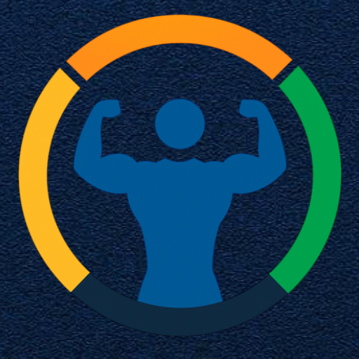
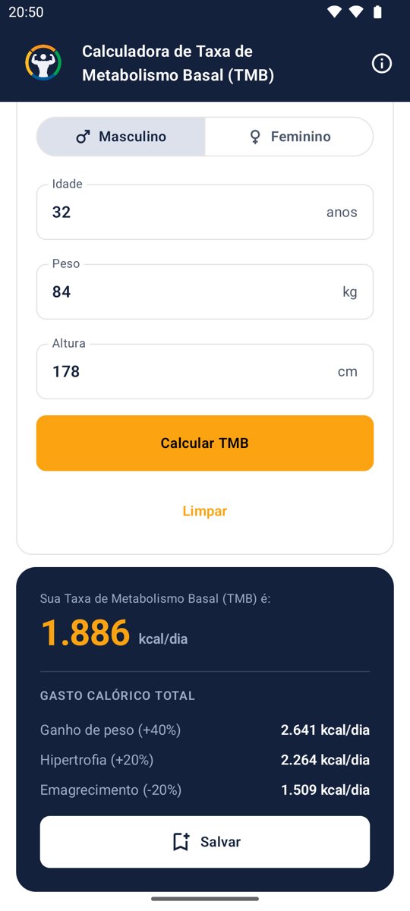
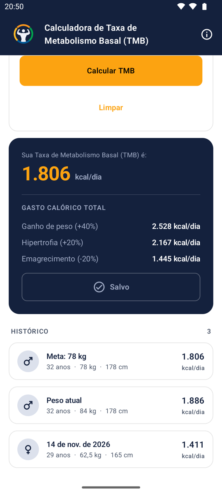
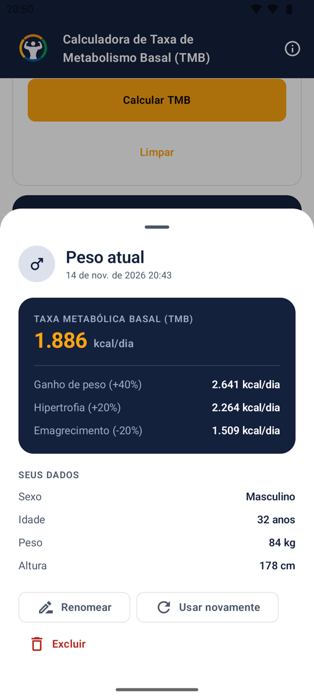
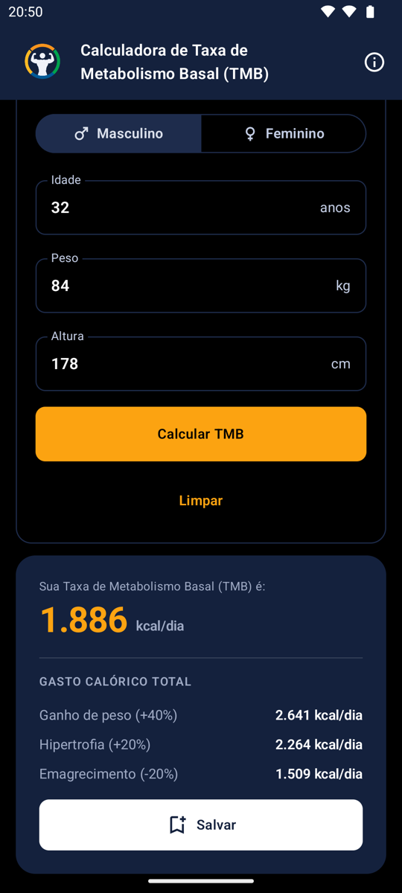

<p align="center">
  
</p>

<h1 align="center">Calc TMB</h1>

<p align="center">
  Aplicativo Android que calcula a sua <b>Taxa de Metabolismo Basal (TMB)</b>, estima o gasto calórico diário para cada objetivo e guarda os cálculos num histórico no próprio aparelho.
</p>

<p align="center">
  <a href="https://play.google.com/store/apps/details?id=com.jammes.calctmb">
    
  </a>
</p>

| Calculadora | Histórico | Detalhes do cálculo | Tema escuro |
| :---: | :---: | :---: | :---: |
|  |  |  |  |

## Funcionalidades

- **Cálculo da TMB**: escolha o sexo e informe idade, peso e altura. O app usa a equação de Harris-Benedict revisada (veja [como o cálculo é feito](#como-o-cálculo-é-feito)).
- **Gasto calórico por objetivo**: junto com a TMB, o app estima as calorias diárias para ganho de peso, hipertrofia e emagrecimento.
- **Histórico**: salve o resultado, com um nome se quiser (por exemplo, "Peso atual" ou "Meta: 78 kg"). Os cálculos sem nome aparecem no histórico com a data em que foram salvos.
- **Detalhes do cálculo**: toque num item do histórico para ver os dados e os resultados, renomear, usar os dados de novo no formulário ou excluir.
- **Validação**: idade de 1 a 120 anos, peso de 1 a 500 kg e altura de 1 a 300 cm, com vírgula ou ponto nas casas decimais. Os campos inválidos ficam destacados.
- **O que é TMB?**: explicação dos conceitos, que aparece na primeira abertura e depois no botão ⓘ do topo.
- **Tema claro e escuro**, de acordo com o aparelho.
- **Português, inglês e espanhol**, de acordo com o idioma do aparelho (em inglês, o app se chama *Calc BMR*).

## Como usar

1. Escolha o sexo e preencha idade, peso e altura.
2. Toque em **Calcular TMB**. A TMB e o gasto calórico por objetivo aparecem logo abaixo do formulário.
3. Toque em **Salvar** para guardar o resultado no histórico, com ou sem nome.
4. Toque num cálculo do histórico para ver os detalhes, renomear, **Usar novamente** ou excluir.

## Como o cálculo é feito

A TMB vem da equação de Harris-Benedict revisada por Roza e Shizgal (1984), com o peso em kg, a altura em cm e a idade em anos:

| Sexo | TMB (kcal/dia) |
| --- | --- |
| Masculino | 88,362 + 13,397 × peso + 4,799 × altura − 5,677 × idade |
| Feminino | 447,593 + 9,247 × peso + 3,098 × altura − 4,330 × idade |

O gasto calórico de cada objetivo é uma proporção da TMB:

| Objetivo | Cálculo |
| --- | --- |
| Ganho de peso | TMB × 1,4 (+40%) |
| Hipertrofia | TMB × 1,2 (+20%) |
| Emagrecimento | TMB × 0,8 (−20%) |

Por exemplo, um homem de 32 anos, com 84 kg e 178 cm, tem TMB de 1.886 kcal/dia, e o app estima 2.641 kcal/dia para ganho de peso, 2.264 para hipertrofia e 1.509 para emagrecimento.

> [!IMPORTANT]
> O app oferece uma estimativa. Para um plano personalizado, consulte um nutricionista ou médico.

## Privacidade

- Os cálculos salvos ficam no próprio aparelho e só saem dele no backup do Android, quando o backup está ativado. O app funciona sem internet.
- Quando há conexão, o app envia ao Firebase (Google) relatórios de falhas e estatísticas de uso, sem nenhum dado corporal (sexo, idade, peso, altura, resultados ou nomes dos cálculos) e sem o ID de publicidade.
- O app não tem anúncios e não pede acesso a recursos do aparelho.

## Tecnologias

- **Kotlin** e **Jetpack Compose** com **Material 3**
- **MVVM** com fluxo de dados unidirecional: a tela envia ações ao `ViewModel` e desenha o estado que ele expõe
- **Room** para o histórico, com os schemas versionados em `app/schemas`
- **Koin** para injeção de dependências
- **Coroutines** e **Flow**
- **Firebase Analytics** e **Firebase Crashlytics**, para as estatísticas de uso e os relatórios de falhas
- **Google Play In-App Review**, para convidar a pessoa a avaliar o app depois de salvar um cálculo
- **R8** no build de release, que encolhe o código e tira os recursos sem uso
- **JUnit** e **kotlinx-coroutines-test** nos testes de unidade

O app roda no Android 7.0 (API 24) ou superior.

## Estrutura do projeto

```text
app/src/main/java/com/jammes/calctmb/
├── domain/   # modelos, casos de uso e interfaces dos repositórios
├── data/     # implementações com Room, SharedPreferences, Firebase e Google Play
├── di/       # módulos do Koin
└── ui/       # tela da calculadora, ViewModel, componentes, diálogos e tema
```

## Como rodar o projeto

1. Clone o repositório:
   ```bash
   git clone https://github.com/JamesWillian/CalcTMB.git
   ```
2. Abra a pasta no Android Studio e espere a sincronização do Gradle. Use uma versão recente, compatível com o Android Gradle Plugin definido em `gradle/libs.versions.toml`.
3. Conecte um aparelho ou inicie um emulador e clique em **Run**.

O `app/google-services.json` já está no repositório, então o projeto compila sem configuração extra. No build de debug, a coleta do Analytics e do Crashlytics fica desligada: o que você testar não chega aos painéis do Firebase.

Pelo terminal, para gerar o APK de debug e rodar os testes de unidade:

```bash
./gradlew assembleDebug
```

```bash
./gradlew test
```

## Contribuição

Contribuições são bem-vindas! Para contribuir:

1. Faça um fork do repositório.
2. Crie uma branch para a sua funcionalidade ou correção:
   ```bash
   git checkout -b minha-nova-funcionalidade
   ```
3. Faça as alterações, confira se os testes passam (`./gradlew test`) e faça o commit:
   ```bash
   git commit -am 'Adiciona nova funcionalidade'
   ```
4. Envie a branch:
   ```bash
   git push origin minha-nova-funcionalidade
   ```
5. Abra um Pull Request.

## Licença

Este projeto está licenciado sob a Licença MIT - veja o arquivo [LICENSE](LICENSE) para mais detalhes.

## Contato

Se você tiver dúvidas ou sugestões, sinta-se à vontade para abrir uma issue neste repositório ou me contatar diretamente.

---

**Autor:** James Willian Da Mata  
**E-mail:** jammeswm@gmail.com  
**GitHub:** [https://github.com/JamesWillian](https://github.com/JamesWillian)

---
